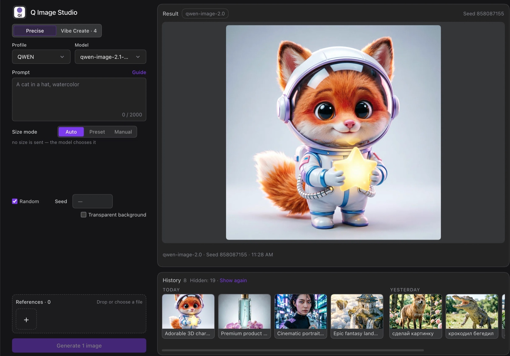

# Q Image Studio

Make images with Qwen without leaving DeepSeek Harness. Four directions at once or one perfect shot, every knob yours, exact repeats when you want them — and references to keep refining until you love it.

**EN** · [RU](#русский)



## What it is

Q Image Studio is a DeepSeek Harness plugin for Qwen image models. It gives you a full working page inside DSH: write a prompt, attach reference images, pick a model and a size, generate, and keep every result on your own disk with its parameters.

It is built for people who iterate on prompts and want the resulting files, with their parameters, on their own disk.

## Features

- **Two modes** — *Precise* makes one image; *Vibe Create* makes four independent images with different seeds, so you can pick the direction you like.
- **Real size control** — auto, a preset long side with aspect ratio and live pixel count, or exact width and height.
- **Repeatable results** — a fixed seed reproduces the same image; the plugin turns off prompt enhancement for exact repeats.
- **Transparent background** — asks Qwen for an RGBA image, then verifies the alpha channel actually arrived.
- **References** — drag images from the history, drop files from Finder, or paste from the clipboard.
- **History and lightbox** — every result keeps its prompt, model, size, seed and date; click a card to see everything and reuse the settings.
- **Prompt guide** — a short English digest of Qwen prompt-writing advice, one click away from the prompt field.
- **English and Russian** interface, switchable in the plugin settings.

## Install

```bash
dsh plugin add @u-cha/dsh-q-image-studio
```

Or open **DSH → Plugins → Install** and paste `@u-cha/dsh-q-image-studio`. Restart DSH if the GUI asks for it.

## Connect a provider

1. Get a DashScope API key in [Alibaba Cloud Model Studio](https://modelstudio.console.alibabacloud.com/) (international) or [Bailian](https://bailian.console.aliyun.com/) (China).
2. Open **Plugins → Q Image Studio**, add a profile, and enter `https://dashscope-intl.aliyuncs.com` (international) or `https://dashscope.aliyuncs.com` (China).
3. Paste the key and press **Test connection**. Only Qwen image models are listed — pick one and save.

The key is stored in the DSH credential vault and is not written into the plugin config, `index.json`, or logs. The vault is a file readable by your operating system user, so anyone with access to your account — including tools and agents running as you — can read it. Keep your machine and account secure.

## Using it

1. Open **Q Image Studio** in the sidebar.
2. Write a prompt in English for best results, and add references if you are editing an existing image.
3. Choose the mode, the model and the size, then press **Generate**.
4. Click any result to see its parameters; reuse them or send the image to the next prompt as a reference.

Images and `index.json` live in `~/Images/Q-Image-Studio` by default; the folder can be changed in the plugin settings.

## Limitations and requirements

- Built for Qwen image models (`qwen-image-*`). Other models and providers are not guaranteed to work.
- Editing by reference needs a DashScope-compatible endpoint.
- Transparency depends on the selected Qwen model; Q Image Studio warns when a result has no alpha channel.
- Quotas and model availability come from your DashScope account. `403 AllocationQuota.FreeTierOnly` means the free tier for that model is exhausted — switch the model or enable billing.
- Works with DeepSeek Harness `0.2.2` builds.

## License

MIT © u-cha

---

## Русский

[English](#q-image-studio)

Создавайте изображения на Qwen, не покидая DeepSeek Harness. Четыре направления сразу или один идеальный кадр, все настройки под вашим контролем, точные повторы когда нужно — и референсы, чтобы доводить результат, пока он вам не понравится.

Плагин для тех, кто подбирает промпты и хочет получить готовые файлы вместе с их параметрами на своём диске.

### Возможности

- **Два режима** — *Точно* делает одну картинку; *Vibe Create* делает четыре независимые картинки с разными сидами, чтобы выбрать понравившееся направление.
- **Настоящее управление размером** — авто, пресет длинной стороны с соотношением и подсчётом пикселей, или точные ширина и высота.
- **Повторяемый результат** — фиксированный сид воспроизводит ту же картинку; для точного повтора плагин отключает улучшение промпта.
- **Прозрачный фон** — просит у Qwen RGBA-изображение и затем проверяет, что альфа-канал действительно пришёл.
- **Референсы** — перетащите картинку из истории, файл из Finder или вставьте из буфера обмена.
- **История и просмотр** — у каждого результата сохраняются промпт, модель, размер, сид и дата; по клику видно всё и можно повторить настройки.
- **Гайд по промптам** — краткая английская выжимка советов для Qwen в одном клике от поля промпта.
- **Интерфейс на английском и русском**, переключается в настройках плагина.

### Установка

```bash
dsh plugin add @u-cha/dsh-q-image-studio
```

Или откройте **DSH → Plugins → Install** и вставьте `@u-cha/dsh-q-image-studio`. Перезапустите DSH, если интерфейс попросит.

### Подключение провайдера

1. Получите ключ DashScope в [Alibaba Cloud Model Studio](https://modelstudio.console.alibabacloud.com/) (международный) или [Bailian](https://bailian.console.aliyun.com/) (Китай).
2. Откройте **Plugins → Q Image Studio**, добавьте профиль и укажите `https://dashscope-intl.aliyuncs.com` (международный) или `https://dashscope.aliyuncs.com` (Китай).
3. Вставьте ключ и нажмите **Проверить**. Будут показаны только модели Qwen для изображений — выберите модель и сохраните.

Ключ хранится в волте DSH и не попадает в конфиг плагина, `index.json` или логи. Волт — файл, доступный вашему пользователю ОС, поэтому любой, у кого есть доступ к вашей учётной записи (включая инструменты и агентов, запущенных от вашего имени), может его прочитать. Следите за безопасностью машины и аккаунта.

### Как пользоваться

1. Откройте **Q Image Studio** в сайдбаре.
2. Напишите промпт — лучше по-английски, — и добавьте референсы, если редактируете готовую картинку.
3. Выберите режим, модель и размер, затем нажмите **Сгенерировать**.
4. Кликните по результату, чтобы увидеть параметры; их можно повторить или отправить картинку в следующий промпт как референс.

Картинки и `index.json` по умолчанию лежат в `~/Images/Q-Image-Studio`; папку можно изменить в настройках плагина.

### Ограничения и требования

- Плагин рассчитан на модели Qwen для изображений (`qwen-image-*`). Работа с другими моделями и провайдерами не гарантируется.
- Редактирование по референсам требует DashScope-совместимого эндпоинта.
- Прозрачность зависит от выбранной модели Qwen; если в результате нет альфа-канала, Q Image Studio предупредит.
- Квоты и доступность моделей определяются вашей учётной записью DashScope. `403 AllocationQuota.FreeTierOnly` означает, что бесплатный лимит этой модели исчерпан — смените модель или включите оплату.
- Работает со сборками DeepSeek Harness `0.2.2`.

### Лицензия

MIT © u-cha
